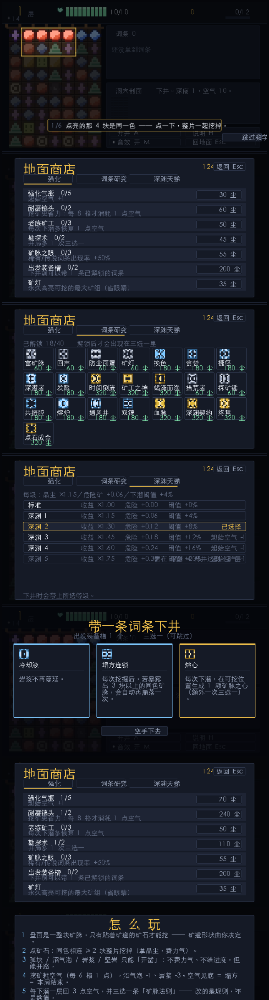
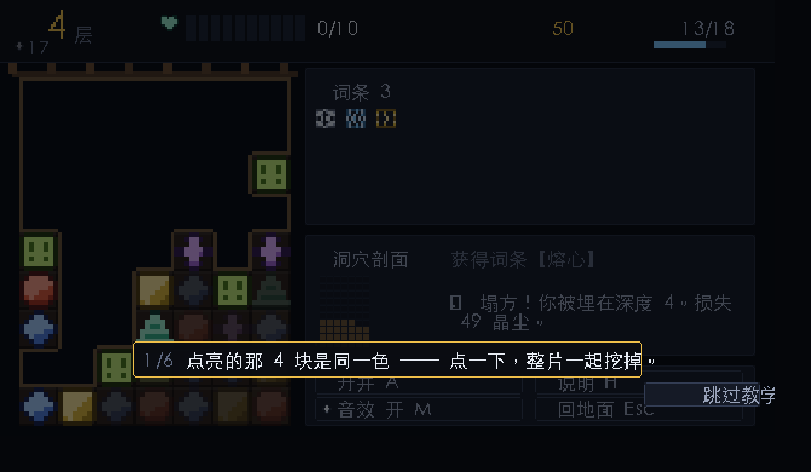
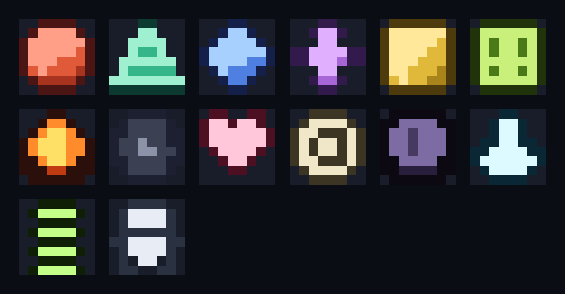

# 《矿脉 Deep Vein》设计文档 v1.0

> 类型：像素风 · 消除 × 肉鸽 · 单机 · 一击即玩
> 平台：浏览器（单文件夹，双击 `index.html` 即玩）／后续可移植到 Godot
> 时长：单局 3–10 分钟，随时可退，无体力、无日常
> 状态：**可玩原型已实现并通过自动化验收**（`src/` 约 1900 行）

---

## 0. 一页速览

| | |
|---|---|
| **一句话** | 你以为你在消除方块，其实你在给自己挖坟。 |
| **核心动词** | 点。 |
| **核心张力** | 挖矿要花氧气，越深越肥，但氧气见底就是塌方=本局结束。什么时候升井，是全游戏唯一的重大决策。 |
| **原创钩子** | 盘面即地图：**你只能挖「贴着矿道」的矿石**，所以矿道的形状完全由你亲手挖出来，每局都长不一样。 |
| **肉鸽改什么** | 不改数值，**改规则**（26 条词条，每条都在改写挖掘/氧气/危险矿的法则）。 |
| **消除形式** | 同色 4-连通块点击消除（SameGame 一脉），**不是交换三消** —— 代码量约为三消的 1/3，反馈更爽。 |
| **零素材依赖** | 全部像素图与音效均为自研/程序生成，无版权风险，无加载。 |

### 核心参数（与代码 `src/core.js` 的 `CFG` 一致）

| 参数 | 值 | 说明 |
|---|---|---|
| 盘面 | 7 列 × 9 行 | 63 格 |
| 矿石颜色 | 4 种（深度 1–2）／5 种（深度 ≥3） | 每种一个**独立形状**，色盲可玩 |
| 初始空气 | 10（+永久强化） | 上限 10（词条可改） |
| 挖矿耗氧 | **每 6 格 1 点** | 主要消耗来源 |
| 开凿耗氧 | **0**（孤块/沼气泡/岩浆）；坚岩 2 | 免费开路，但不给进度 |
| 沼气泡／岩浆伤害 | 1 ／ 3 | 岩浆从深度 5 出现 |
| 下潜所需挖掘量 | `12 + 2×(深度-1)`，上限 30 | 只统计**真正挖掉的矿脉**，开凿不计 |
| 下潜恢复 | 3 点空气 | |
| 塌方 | 本局结束，损失本局 **50%** 晶尘 | 深度纪录与词条库保留 |
| 深度收益 | `×(1 + 0.18×(深度-1))` | 越深越肥 |
| 危险矿加成上限 | ×1.6 | 防止贪婪系词条叠成必死局 |
| 精英危险矿 | 深度 6+ 起稀有出现（深岩 8+、毒气矿脉 9+） | 深岩挖不动且向下生长；晶簇是补给点；毒气矿脉会污染矿石 |
| 词条 | **40 条**（普通 16 / 稀有 15 / 传说 9） | 全部改写规则 |
| 成就 | **24 条**，解锁即发晶尘 | 刷成就和变强是同一条线 |
| 每日挑战 | 日期派生 6 位种子，同一座矿 | 可互相报成绩 |
| 深处空气稀薄 | 深度 ≥15 起下潜恢复减半 | 与二次项一起收口长局 |
| 下潜需求 | `12 + 2×(深度-1) + 0.5×(深度-15)²`（15 层起二次增长） | **刻意不封顶**，这是长局的墙 |
| 空气补给配额 | 每层最多 1 个晶簇 + 1 个矿脉之心 | 不设配额会变成"挖得越多补得越多"的永动 |
| 起步词条 | 18 / 40 条 | 其余 22 条用晶尘研究解锁 |
| 长期晶尘目标 | **7665**（强化 3445 + 词条解锁 4220） | 约 9 局买光，此前是 1.5 局 |
| 深渊天梯 | 20 级，每级 收益 ×(1+0.15L) / 危险 +0.06L / 阈值 +4%L | 无限精通线 |
| 新手教学 | 脚本化首局 + 聚光灯 + 6 步 | 首次下井自动触发，可跳过 |

## 0.5 长期目标：三条并行的长线

原版只有 6 项强化、总价 **855 晶尘**，而单局产出 400–700 —— **1.5 局就能把商店搬空**，
这是"没有游玩动力"的定量原因。现在拆成三条并行长线：

| 长线 | 内容 | 晶尘 |
|---|---|---|
| **词条研究**（内容解锁） | 40 条词条只给 18 条起步，其余 22 条逐条解锁后才进三选一池 | 4220 |
| **强化加深** | 7 项，等级加深（气瓶 5 级、镐头 2 级、老练 3 级、眼睛 3 级…） | 3445 |
| **深渊天梯**（精通线） | 在 N 级升井达到 `10+2N` 层才解锁 N+1 级；每级同时加压与加价 | 无限 |

`tools/meta-sim.js` 会模拟 40 局的完整元进程（存钱 → 按理性顺序消费 → 报告解锁时间表）：

```
 局  深度  本局晶尘   余额  深渊  剩余可买
  1     9       580      5     0        23
  5     9       605    287     2         9
  9    10      1302    825     2         0     ← 第 9 局买光全部长期目标
 10    23     10035  10860     3         0     ← 满配后的"神局"
```

> 单局模拟负责"这一局好不好玩"，**元进程模拟负责"这游戏能玩多久"** —— 两者要分开测。
> 上面这个工具第一次跑就抓出了"单局 20 万晶尘"的漏洞（见 §8.3 bug #6）。
| 内部画布 | **640×360**，整数倍最近邻放大 | 老版本 480×270 塞得下太多文字 |
| 正文最小字号 | **16px 点阵**（自研字库 618 字） | 用字号物理限制字数，逼出克制 |
| HUD 汉字数 | **1 个**（只有"层"） | 其余全部用图标 + 数字 |

---

## 1. 设计支柱

1. **一个动词就够。** 全程只有一个操作：点。没有任何需要记的组合键、没有资源条要盯。规则 6 句话讲完（游戏内 `H` 键）。
2. **规则一眼可见。** 「够不着的矿石画得很暗，能挖的画亮」——这一条 UI 规则承担了整个游戏的教学。玩家不需要读说明就会自己发现"只能挖贴边的"。
3. **风险由玩家自己决定。** 游戏永远不会"催你"。你可以随时升井，也可以贪一层。所有损失都是自己选的。
4. **每局都长出新东西。** 词条改的是规则不是数值，所以第 30 局仍然会遇到没见过的连锁。

---

## 2. 核心循环

**秒级**：看盘面 → 找最大的同色连通块 → 点 → 碎石飞溅 + 音高递增的琶音 + 晶尘数字跳起来
**分层级（3–10 分钟）**：挖矿推进度 → 下潜一层 → 三选一改写法则 → 危险矿变多、岩浆蔓延 → 氧气吃紧 → **决策：升井落袋 or 再挖一层**
**元进程（长期）**：晶尘 → 地面商店 6 项永久强化 → 更强的开局 → 更深的纪录

---

## 3. 规则精确定义

### 3.1 盘面与"矿道"

- 盘面初始**全是矿**（7×9）。
- 盘面**上方那条横巷是入口**（虚拟空腔），所以第 0 行永远可以挖。
- 判定：**一个格子可挖 ⟺ 它 4-邻接任一空格，或它在第 0 行。**

### 3.2 点击判定优先级（`core.actionFor`）

| 目标 | 条件 | 结果 | 耗氧 | 进度 | 晶尘 |
|---|---|---|---|---|---|
| 矿石 | 同色 4-连通 ≥2 且贴矿道 | **挖矿** | 每 6 格 1 点 | ✅ 计入 | ✅ `n+(n-2)` × 深度 × 加成 |
| 矿石 | 连通块 =1（孤块） | **开凿** | 0 | ❌ | 0（有【淘金】才给分） |
| 沼气泡 | 贴矿道 | 开凿 | 伤害 1 | ❌ | 0 |
| 岩浆 | 贴矿道 | 开凿 | 伤害 3 | ❌ | 0 |
| 坚岩 | 贴矿道 + 有【硬头】 | 开凿 | 2 | ❌ | 0 |
| 矿脉之心 | 贴矿道 | 拾取 | 0 | ❌ | +12 且 **空气 +1** |
| 化石 | 贴矿道 | 拾取 | 0 | ❌ | +6 |
| 任意 | 不贴矿道 | 无效（抖动 + 拒绝音） | — | — | — |

**为什么孤块开凿必须免费**：早期版本让它也扣 1 点空气，模拟器实测显示每层后期边界几乎全是单块，玩家被"千刀万剐"式耗死，而危险矿反而从不被触碰。改成免费后（但**不给下潜进度**），玩家可以零成本开路、把矿脉切出新的面，氧气只由"真正挖矿"和"危险矿"消耗——经济瞬间变得可读。

### 3.3 无重力，但会滚屏

- 矿石**不下落**：矿道一旦挖开就永久保留，「空腔的形状 = 你这局的地图」。
- 当**最底行出现空格**时，整块盘面上滚一行、底部补一行新矿 → 视角跟着矿道往下走。
- 深度进度只由挖矿驱动，与滚屏无关（防止零成本刷深度）。

### 3.4 下潜与压力递增

- `dugInLevel ≥ 12 + 2×(深度-1)`（上限 30）→ 深度 +1，空气 +3，弹一次三选一。
- 深度 3+ 出现矿脉之心；深度 5+ 出现岩浆，且**每次下潜岩浆向邻接矿石蔓延 1–3 格**（深度 5–9 蔓延 1，10–14 蔓延 2，15+ 蔓延 3）。
- 新生成矿石的危险矿概率随深度线性上升并封顶：沼气泡 ≤15%，坚岩 ≤12%，岩浆 ≤9%。

### 3.5 死局处理：由引擎保证，而不是靠图块自觉

早期设计里"开凿永远免费且永远可用"，所以死局不存在。但加入**精英危险矿**之后就不成立了：
深岩挖不动、没有【硬头】时的坚岩也挖不动，它们可以把矿道彻底围死。

于是加了一层**通用死局保险** `core.ensurePlayable()`：
1. 每次操作后（含滚屏、下潜、精英蔓延之后）扫描是否还存在合法操作；
2. 若没有，就在贴边处"用炸药"炸开 —— **先试炸再还原，只炸真正能开路的那一块**，单炸无效才连炸。

两个设计上的好处：炸的必然是贴边格，所以新空腔必然与矿道连通，**不破坏"矿道始终连通平巷"这条核心不变式**；
而且以后再加任何"不可挖"的图块，都自动被这层兜住，不需要逐个打特例。

---

## 4. 词条系统（肉鸽的灵魂）

### 4.1 数据结构

```js
{ id, name, desc, rarity,          // 0 普通 / 1 稀有 / 2 传说
  unique?, maxStack?, charges?,    // 唯一 / 可叠层数 / 主动技能次数
  flags: {...},                    // 静态加成，自动聚合
  onDig(ctx), onDescend(ctx),      // 行为钩子
  onAcquire(ctx), active(ctx) }    // 获得时 / 主动使用
```

**加一条词条 = 加一个对象。** `flags` 按类型自动聚合（`scoreMul`/`thresholdMul`/`hazardMul` 乘算，`digRadius`/`autoChain` 取最大，其余加算），**并且对乘算型 flag 强制封顶**。

### 4.2 全表（40 条）

#### 普通（16 条，权重 66）


| 名称 | 效果 |
|---|---|
| 共鸣 | 同色累计挖满 8 块后，下次挖它时波及整圈 4-邻接并清零 |
| 顺手 | 一次挖掉 ≥6 块，额外 +3 晶尘 |
| 精准 | 一次恰好挖掉 4 块，额外 +10 晶尘 |
| 回声 | 一次挖掘中，超过 3 块的部分每块 +1 晶尘 |
| 富矿脉 | 晶尘 +40%，新矿中危险矿 +20% |
| 安全帽 | 空气上限 +2 |
| 空气囊 | 每次下潜额外恢复 1 点空气 |
| 轻镐 | 每挖 9 格才消耗 1 点空气 |
| 拾荒者 | 矿脉之心 / 化石 / 晶簇 的晶尘翻倍 |
| 矿车 | 矿脉每上滚一行 +4 晶尘 |
| 探矿锤 | 开凿孤块时 35% 概率白捡 5 晶尘 |
| 淘金 | 开凿孤块也能得晶尘 |
| 防尘面罩 | 沼气泡不再造成伤害 |
| 勘探 | 下潜所需挖掘量 -15% |
| 矿灯 | 持续高亮场上最大的矿脉 |
| 厚手套 | 岩浆伤害 -1 |

> 16 普通 + 15 稀有 + 9 传说 = **40 条**。

#### 稀有（15 条，权重 26）

| 名称 | 效果 |
|---|---|
| 塌方连锁 | 挖完后若暴露出 ≥3 的同色矿脉，自动再崩落一次 |
| 换色 | 主动（2 次）：把某色矿石全部变成另一色 |
| 贪婪 | 晶尘 +60%，新矿中危险矿 +40% |
| 掘进 | 下潜所需挖掘量 -25% |
| 硬头 | 可镐击坚岩 |
| 冰镐 | 凿开坚岩不消耗空气 |
| 捷径 | 主动（3 次）：打一口直井，立刻下潜 1 层 |
| 双生 | 挖矿时 30% 概率把紧邻的异色矿染成同色并一起挖掉 |
| 双镐 | 挖矿时 25% 概率这一镐不费力气 |
| 熔炉 | 岩浆不再烫伤，反而每凿开一处 +12 晶尘 |
| 通风井 | 每下潜 2 层额外弹一次三选一 |
| 深潜者 | 深度 ≥8 后所有收益 ×1.5 |
| 冷却液 | 岩浆不再蔓延 |
| 发酵 | 每次下潜在可挖位置生成 1 块化石 |
| 共振腔 | 自带共鸣，阈值 8 → 5 |

#### 传说（9 条，权重 8）

| 名称 | 效果 |
|---|---|
| 大地脉动 | 每累计挖 12 格，自动引爆场上最大的一处矿脉 |
| 终焉 | 每累计挖 30 格，自动引爆场上最大的 **3** 处矿脉 |
| 血脉 | 每累计挖 20 格，空气上限 +1（本局最多 +5）—— 越挖越强 |
| 熔心 | 每次下潜在可挖位置生成 1 颗矿脉之心 |
| 时间倒流 | 本局第一次塌方不造成任何损失 |
| 矿工之神 | 下潜所需 -35%，且每次下潜额外 +1 空气 |
| 深渊契约 | 每次下潜都额外弹一次三选一，但空气上限 -2 |
| 竭泽而渔 | 晶尘 ×2，但空气上限 -3 |
| 点石成金 | 推翻核心规则：开凿孤块也能推进下潜进度，但每次要花 1 点空气 |

### 4.3 词条组合示例

- **共鸣 + 双生 + 塌方连锁** → 一次点击能连锁引爆三次，盘面像雪崩
- **贪婪 + 轻镐 + 空气囊** → 高风险高收益的"资本家流"，靠氧气经济撑住贪婪的代价
- **矿灯 + 掘进 + 捷径** → 速通流，一路往下不打磨
- **时间倒流 + 竭泽而渔** → 赌狗流：上限只有 7 点空气，但收益翻倍，用一次免死兜底

---

### 4.4 精英危险矿（深度 6+ 起）

普通危险矿只是"绕开就行"的路障。**精英必须让玩家做选择**——这是从"地图装饰"升级到"地图机制"的关键。

| 精英 | 出现深度 | 行为 | 玩家要做的选择 |
|---|---|---|---|
| **晶簇** | 6+（约 2–3 处/局） | 只能凿开：**+30 晶尘、空气 +1** | 它是补给点 —— 值得为它绕路吗？ |
| **深岩** | 8+ | **挖不动**（连【硬头】也没用），且**每下潜一层向下生长 1 格** | 它会永久改变矿道走向：现在改道，还是花空气从旁边凿过去？ |
| **毒气矿脉** | 9+ | 凿开 **-2 空气**，且**每层把 1 个相邻矿石污染成沼气泡** | 越拖越糟：先处理它，还是永远绕开？ |

**实现要点（踩坑记录）**：精英图块是"不可挖"的，天然会引出死局问题。见 §8.3 的 bug #4。

### 4.5 长线留存：成就 + 每日挑战

**成就（24 条）**
- 分两类：`live`（对局中即时判定，如"一次挖掉 20 块"）与 `final`（结算时判定，如"零塌方到 10 层"）。
- **解锁即发晶尘，直接进地面商店的余额** —— 让"刷成就"和"变强"是同一条线，而不是两套并行系统。
- 例：一网打尽(+60)、雪崩(+140)、深渊行者 30 层(+700)、图鉴全开 40 条词条(+1000)、每日打卡 5 次(+300)。
- 判定全部是纯函数，方便无头测试（`VeinAchievements.live(s, meta)` / `.final(sum, meta)`）。

**每日挑战**
- 用**当天日期**派生一个 6 位种子（先做一次 xorshift 混淆，否则相邻日期的矿会长得很像）→ 所有人当天玩到的是**同一座矿**，可以互相报成绩、比谁挖得深。
- 标题页显示"今日最好 X 层 / Y 晶尘 / 已试 N 次"，结算页显示"每日 2026-10-09 种子 #443010"。
- 不做"每天只能打一次"的限制 —— 消磨时光的游戏不该惩罚重玩，只记录当日最好成绩。

## 4.6 新手教学（脚本化首局）

正面回答"开始都不懂设定"：**不做说明书，做一次被引导的首局。**

- 首次下井自动进入教学：盘面被改写成"一定有东西可教"——第 0 行一条 4 连、第 1 行一个孤块、
  第 2 行一个守在必经之路上的沼气泡。
- 六步，每步**只说一件事**，并配一圈**聚光灯**（把其余部分压暗，目标格描金边呼吸）：
  1. 同色相连 ≥2 整片挖掉　2. 孤块只能开凿（不费力气也不推进度）　3. 危险矿要付代价
  4. 空气就是命　5. 下潜会三选一条法则　6. 随时可以升井
- **不阻塞**：玩家做别的也能继续，某一步的目标因为盘面变化而消失时自动跳过该步。
- 完成（或跳过）后置 `tutorialDone`，完成额外给 120 晶尘；帮助页里有「重看新手教学」。
- 实现是 6 条 `{文案, 目标函数, 完成条件}` + 一层遮罩，约 120 行。

> 设计原则同 §6.1：**用画面引导，不用文字解释。** 聚光灯比一段"规则说明"有效得多。

## 5. 经济与元进程

- **晶尘**（局内货币）：挖矿获得，随深度与词条放大。
- **升井**：100% 落袋。
- **塌方**：只带走 50%，本局结束。
- **地面商店**（6 项永久强化，跨局保留）：

| 强化 | 效果 | 价格 |
|---|---|---|
| 强化气瓶 | 起始空气 +1（3 级） | 30 / 70 / 150 |
| 耐磨镐头 | 每 8 格才消耗 1 点空气 | 60 |
| 老练矿工 | 每次下潜多恢复 1 点（2 级） | 50 / 120 |
| 勘探术 | 开局多 1 次三选一（2 级） | 45 / 110 |
| 矿脉之眼 | 稀有/传说词条出现率 +50%（2 级） | 55 / 130 |
| 矿灯 | 永久高亮最大矿组 | 35 |

存档：`localStorage`，key `deepvein.meta.v1`（被浏览器拒绝时自动降级到内存，不崩）。

---

## 6. UI / UX

### 6.1 一条硬约束：正文最小 16px 点阵

老版本的内部画布是 480×270、正文用 9–10px 系统字体 —— **能塞下更多字，于是就把字都塞进去了**。
加了词条、精英、成就、每日之后，侧栏变成了一堵字墙（这正是这轮返工的原因）。

改成 **640×360 内部画布 + 16px 点阵正文**之后，"一行能放多少字"被物理限制了：
侧栏一行只放得下 17 个汉字。文案被迫变短、层级被迫拉开、说明被迫挪去悬停。

> **用字号逼出克制，比靠自觉克制可靠。** 这是这一轮最大的设计收获。

### 6.2 布局（640×360 内部，整数倍最近邻放大）

```
┌──────────────────────────────────────────────────────────────────────┐
│ ⛏ 7 层      ♥ ▮▮▮▮▮▮▮▮▮▯ 9/10      ◆ 230  ★17      ▤ 0/28 ▓▓░░░      │ 状态条 52px
├─────────────────────────────┬────────────────────────────────────────┤
│ ══════ 平巷（入口横梁）══════ │  符 词条 6                              │
│ ┌──┬──┬──┬──┬──┬──┬──┐      │  ▨ ▨ ▨ ▨ ▨ ▨                            │  词条卡
│ │▓▓│▓▓│  │  │  │░░│▓▓│      │                                        │  （只有符文，
│ │▓▓│  │  │██│  │  │▓▓│ ←亮  │  ┌─────────┐  下潜至深度 7，空气 +4。    │   没有名字）
│ │  │  │▓▓│▓▓│  │  │▓▓│      │  │▦▦▦▦▦▦▦│                            │
│ │  │▓▓│▓▓│▓▓│  │  │▓▓│      │  │▦▦▦▦▦▦▦│  获得词条【矿车】           │  洞穴剖面卡
│ │▓▓│▓▓│▓▓│▓▓│▓▓│▓▓│▓▓│      │  │▦▦▦▦▦▦▦│                            │  （替代了文字日志）
│ └──┴──┴──┴──┴──┴──┴──┘      │  └─────────┘                          │
│  7×9 格，每格 32px            │  ┌───────────┬───────────┐            │
│  亮=可挖 暗=够不着            │  │ ◆ 升井 A  │ 说明 H     │            │  按钮卡
│                              │  │ ★ 音效 M  │ 回地面 Esc │            │
└─────────────────────────────┴────────────────────────────────────────┘
```

### 6.3 信息设计的三条规则

1. **能用图标 + 数字说清的，绝不用文字。** HUD 上只剩下一个汉字（"层"）：深度=镐、空气=心、
   晶尘=宝石、进度=梯子、成就=星、每日=日历。连"纪录"都换成了一个星形图标 + 数字。
2. **每块信息只出现一次。** 词条在侧栏只显示**符文**（8×8 程序化生成），名字与说明挪到悬停时才
   出现在旁边的卡片里 —— 于是侧栏从"词条名列表"变成了"你的战利品陈列"。
3. **空出来的地方用来放"你挖出来的东西"，而不是放说明文字。** 这就是洞穴剖面。

### 6.4 洞穴剖面（本轮新增的创意功能）

每下潜一层记一行，记录**这一层你挖开了哪几列**。它同时是三样东西：

- **地图**：一局下来，这就是你亲手挖出来的那座矿的剖面。
- **回忆/分享物**：结算时它是天然的战绩图（下一步可以做成可导出的分享图）。
- **空间填充物**：它占掉的位置，正是原来最占地方的那块文字日志。

实现只有十几行：`App.cave[depth-1] |= (1 << 列号)`，渲染时画成 7 列 × 10 行的小方块。

### 6.5 自研点阵字体

真·像素中文字体（Zpix / 方舟像素）要么商用收费、要么下载不下来（本机 GitHub release 不可达）。
于是自己造：**扫描项目里所有会被显示的字符（618 个）→ 用系统字体在 16×16 网格上光栅化 →
二值化成 1-bit 点阵 → 打包成 87 KB 的 `src/pixfont.js`**。

- 16px 是点阵中文的黄金尺寸（12px 实测笔画会糊成一团）。
- 拉丁与汉字**共用一个行盒、不裁剪 ink bbox** —— 否则数字会整体上浮，和汉字混排时歪得很明显。
- 运行时把十六进制行展开成整数位图，渲染就是纯位运算（每帧几百字符毫无压力）。
- 零外部字体文件、零授权风险。想换成 OFL 的方舟/缝合像素字体也很容易（见素材清单）。

### 6.6 关键交互决策

| 决策 | 理由 |
|---|---|
| 够不着的矿石 α=0.30，够得着的 α=1.0 | 用一个亮度差代替整篇教学文案 |
| 悬停即预览整组 + 显示「N 连块 +M」 | 消除的爽感来自"预期→兑现"，必须让预期可见 |
| 悬停危险矿显示「-3」并变红 | 让代价在点击前就看见 |
| 悬停侧栏符文 → 旁边卡片显示名字与说明 | 把文字从"常驻"变成"按需" |
| 无效点击：格子抖动 + 拒绝音 + 短提示 | 玩家永远不会困惑"为什么点不动" |
| 双画布：世界用 640×360 像素画布，UI 用同尺寸但原生分辨率的画布 | 像素图锐利 + 文字锐利，两个都要 |
| 按钮 = 图标 + 2–4 个字 | 长标签被物理禁止 |

### 6.7 实际画面





## 7. 美术与音频规格

### 7.1 像素规格（全部自研，无外部素材）

- 内部分辨率 **480×270**（16:9），整数倍放大（1×–4×），`image-rendering: pixelated`。
- 精灵一律 **8×8**，盘面每格 24px = **3 倍放大**（整数，保证锐利）。
- **形状即身份**：赤铁=圆形、苍铜=三角、蓝荧=菱形、紫晶=星形、硫金=方形。色盲玩家靠形状区分。
- 危险矿用完全不同的轮廓：沼气泡=方框骷髅、岩浆=水滴、坚岩=深色实心岩、矿脉之心=心形、化石=菊石。
- 每套调色板 4 个明度（1 最亮 → 4 最暗兼任描边）。
- **词条符文是程序化生成的**：用词条 id 的哈希 + 左右/上下镜像对称撒点，40 条词条得到 40 枚
  互不相同的徽记（已用脚本验过零碰撞）。加词条零美术成本，而且每枚都是原创。
- **UI 图标 8×8 手绘 8 枚**（镐/心/宝石/梯/符/星/历/矿车），与矿石共用同一套像素语言。
- **文字也是像素**：正文是自研 16px 点阵字库（见 §6.5），不再混用系统字体。



### 7.2 音频（WebAudio 实时合成，0 个音频文件）

| 音效 | 合成方式 |
|---|---|
| 挖矿 | 按连块数触发上行琶音（`220 × 1.09^i`，方波 + 带通噪声）—— **挖 12 块就是一段 12 音的上行音阶**，这是全游戏最重要的正反馈 |
| 开凿 | 高频带通噪声短促一击 |
| 受伤 | 锯齿波下滑 + 低频噪声 |
| 下潜 | 三角波上行 + 噪声扫频 |
| 三选一 | 三音琶音 |
| 塌方 | 1.1 秒噪声下滑 + 低频锯齿，配合屏幕剧烈震动 |
| 洞穴底噪 | 42Hz 锯齿波过低通，音量 0.05 的持续轰鸣 |

---

## 8. 技术方案

### 8.1 架构（纯浏览器，无构建、无依赖）

```
DeepVein/
├── index.html            双画布外壳 + 热键提示
├── src/
│   ├── core.js     (~700 行) 纯逻辑：盘面/连通块/规则/经济/精英/死局保险/词条接口。零 DOM 依赖
│   ├── relics.js   (~300 行) 40 条词条，数据驱动
│   ├── achievements.js (~90 行) 24 条成就（live/final 两类判定）
│   ├── art.js      (~180 行) 8×8 位图 + 调色板 + 最近邻绘制
│   ├── audio.js    (~130 行) WebAudio 合成音效
│   └── app.js      (~660 行) 渲染/交互/UI/元进程/存档
├── tools/
│   ├── sim.js            无头模拟器：500 局 × 2 种打法 + 不变式断言
│   ├── sheet.js          从 art.js 导出 PNG 精灵表与盘面效果图
│   ├── browser-smoke.html 真浏览器同步冒烟测试（含错误捕获）
│   └── scene-shot.html    六个界面的截图生成页
└── assets/               导出的素材与截图
```

**关键工程决策**：`core.js` 完全不碰 DOM，所以它能在 Node 里跑几十万次对局做平衡（本作的全部数值都是这么调出来的），也能在真浏览器里用同一份代码跑冒烟测试。

### 8.2 核心算法

```js
// 判定：贴边才能挖
isFrontier(r,c) = (r === 0) || 任一 4-邻格为 null

// 同色连通块（挖掘目标）
sameGroup(r,c) = 4-邻接 flood fill，同色且为矿石

// 每次挖掘后的顺序
挖掉 → 算分/扣氧 → 判定塌方 → 滚屏（底行有空格就上滚一行）→ 判定下潜 → 弹三选一
```

### 8.3 测试体系（这是本作最值钱的部分）

| 层次 | 手段 | 覆盖 |
|---|---|---|
| 语法 | `node --check` 全部源文件 | — |
| **逻辑不变式** | `tools/sim.js` 500 局 × 2 种打法 | ① **矿道永远连通平巷**（每条空腔都必须能顺着空格走回入口）② 无死局 ③ 空气 ≤ 上限、晶尘 ≥ 0、无 NaN ④ 每局深度 ≥1 |
| 真浏览器 | `tools/browser-smoke.html`（headless Chrome） | 走遍标题/商店/说明/对局/三选一/结算/主动技能/塌方/存档，`window.onerror` 计数必须为 0 |
| 视觉 | `tools/scene-shot.html` → 截图人工核对 | 六个界面 + 精灵表 |

**测试真的抓到了两个致命 bug，都不是靠读代码看出来的：**

1. **矿道断裂**：词条【共鸣】的"波及一圈"用了 8-邻接，会挖到只与主矿组**斜角相接**的格子 → 造出与矿道断开的孤立空腔，直接破坏核心不变式。修复：改成 4-邻接扩圈，并在 `applyAction` 里加了一道"只保留与点击格 4-连通的格子"的安全网。
2. **网格索引环绕**：安全网函数 `keepConnected` 在算 `idx = r*COLS + c` 时**没有先判界**，导致第 6 列的右邻被算成了下一行第 0 列 → 挖到完全无关的格子。这个 bug 只在特定边界盘面出现，静态审查几乎不可能发现。
3. **弹窗被底层按钮"吃掉"（玩家实测报上来的）**：点【玩法说明】再点【返回】会跳到结算页。
   根因是**弹窗打开时，底下侧栏的按钮热区仍然注册着**，而 `hit()` 按插入顺序返回第一个命中：
   - 说明页的【返回】`y=226..246` 压在侧栏【升井】`y=222..240` 上 → 点返回实际点到了升井。
   - 【结算页】的【再下一次井】`y=238..258` 同样压在【升井】上（同类 bug，只是还没被发现）。
   修复：引入**模态层**——只要有弹窗开着（三选一/结算/商店/说明/换色），基础层控件一律不注册热区，
   并在 `hit()` 里再加一道"模态时忽略基础层 key"的保险丝。
   现在 `tools/browser-smoke.html` 里有 **4 条回归测试**用真实 `MouseEvent` 打穿整条 hit 判定路径
   （正常升井 / 说明页返回 / 结算页再下一局 / 三选一跳过），这类 z 序 bug 不会再回来。

   > 教训：**"两个热区重叠"这种 bug 静态读代码永远看不出来，必须用真实坐标去点。**
   > 手算一遍各按钮的矩形范围比读十遍 `onClick` 有效。
   现在 `tools/browser-smoke.html` 里有**热区重叠自动断言**：8 个界面逐帧渲染后两两比较矩形，
   任何重叠直接报错。这是这类 bug 的永久防线，以后加 UI 都不会再踩。

4. **加入精英矿后连环爆出 4 个死局/滚雪球 bug**（都是模拟器 500 局不变式断言抓到的，一次比一次深）：
   - **a. 死局保险只炸一块**：炸掉第 0 行那种"四周本来就是空腔"的坚岩等于没炸，9 个候选里漏掉唯一有效的那块，死局照旧。
     → 改成先试炸再还原、只炸真正能开路的。
   - **b. 【时间倒流】复活路径跳过了 postDig**：玩家在耗尽空气的那一击挖出了最后一块可挖的矿，
     复活后停在一个被围死的盘面上。→ 让 `doCollapse` 返回"是否复活"，复活就继续走完整管线。
   - **c. 精英蔓延在 postDig 之后又改盘面**？不 —— 是**精英蔓延之前**的判定漏了。当时用"随机炸最多 4 格"，
     在 9 个候选里命中唯一有效格的概率只有 56%。→ 同 a。
   - **d. 传奇词条【点石成金】把核心经济推翻了**：它让"免费的开凿"也能推进度 → 零成本无限下潜，
     模拟器跑出 **80 层、900+ 次点击、20 分钟一局**的怪物。→ 改成开凿推进度但每次花 1 点空气，
     并加了"深度 ≥15 起下潜恢复减半"的收口规则，最大深度回到 39 层。

   > 教训：**每加一个"推翻核心规则"的内容，都要回头问一句"这条规则原本在防什么"。**
   > 【点石成金】推翻的是"开凿免费但不推进度"，而这条规则正是防止无限下潜的那道墙。

5. **界面改版又炸出 5 个问题，其中 3 个被新加的自动断言当场抓住**：

   这一轮为 UI 加了三道**自动断言**（都跑在真浏览器里）：
   - **热区重叠**：8 个界面逐帧渲染后两两比较矩形 —— 这是"点返回跳结算页"那类 z 序 bug 的永久防线。
   - **文字越界**：包装渲染器，记录任何画出画布边界的文字。
   - **点阵缺字**：渲染时记录字库里没有的字符 —— 屏幕上就是一块空白，不报错、不崩溃，
     是渲染路径上最典型的静默失败。

   抓到的：
   - **`frame()` 命名冲突 → 无限递归**：我新写的"像素描边"函数叫 `frame()`，而动画循环也叫 `frame()`，
     函数声明提升让后者覆盖了前者 → 画面板时递归调用自己。**同一份文件里两个不同层的东西重名。**
   - **弹窗打开时基础层按钮仍注册热区**（第二次踩同一个坑）：上轮修的是 `buttons[...]` 直接赋值，
     这轮新写的 `btn()` 辅助函数没走那道闸，于是"说明页"里侧栏按钮又活了。→ 给 `btn()` 加 `base` 标记。
   - **给中文串传 2 倍缩放 → 32px/字直接冲出画布**（越界断言抓到）。
   - **16px 正文塞进 20px 行距 → 成就页整页叠字**（截图肉眼发现，光标/断言都测不出来）。
   - **测试脚本把内部画布宽度写死 480**（实际改成 640）→ 点击坐标整体偏移 33%，4 条回归测试全红。

   > 教训：**改了基础尺寸（分辨率/字号）之后，所有"写死的数字"都要重新审一遍** ——
   > 包括测试脚本里的。自动化断言只是把"发现成本"降到接近零，写死的常量仍然要靠人回头看。

6. **元进程第一版被一局打穿（本轮最有价值的一次排查）**：新写的 `tools/meta-sim.js` 报告
   "第 28 局收入 206,644 晶尘、深度 53"。排查链：
   - 先怀疑商店太便宜（确实，855 晶尘）→ 扩容到 7665，**模拟结果一个字没变**；
   - 于是逐层打印空气账本，发现 `累计扣氧 65 / 累计回氧 66`、深度 35 —— **成本恰好被补给抵消**；
   - 真因有三个，叠在一起：
     a. `thresholdMul` 是乘算叠加（掘进 0.75 × 勘探 0.85² × 矿工之神 0.65 ≈ 0.35），
        下潜需求被压到十几格 → **每层净赚氧气**；
     b. `digCostEvery` 省力类叠加到 16，进一步降低成本；
     c. **晶簇/矿脉之心按"生成格数百分比"刷新 +1 空气** —— 挖得越多补得越多，形成永动。
   - 修法：`thresholdMul` 封底 0.5、`digCost` 封顶 12、下潜需求 15 层后加二次项、
     **补给改为每层配额**。深度 53 / 20 万晶尘 → 深度 7 / 773 晶尘。

   > 教训一：**"模拟结果没变化"本身就是最重要的线索** —— 它直接排除了"数值不够大"这个假设，
   > 把范围锁死在"某处有结构性漏洞"。
   > 教训二：**固定收益 + 百分比产出 = 通胀。** 任何"按游玩量百分比刷新"的固定值补给，
   > 最终都会超过消耗。要么给产出设配额，要么让收益随规模递减。

7. **选项名拼错导致右对齐失效**：`tx()` 读的是 `a:`，我在几处写成了 `align:` ——
   TypeScript 会当场报错，纯 JS 只是静默失效，文字冲出画布。**文字越界断言抓到的。**
8. **教学覆盖层盖在商店/说明之上**：`drawTutorial()` 只判断了"不在标题页"，
   没判断"正在弹窗"。→ 收紧为只在对局中显示。
9. **教学步数会无限增长**：自动跳过分支漏了"是否已走完全部步骤"的检查。

10. **界面上一堆"文字不居中 / 冲出按钮"（玩家报的）—— 根因是一个键名拼写**：
    `btn()` 调 `tx()` 时传的是 `align:`，而 `tx()` 读的是 `opt.a` → **所有居中按钮的实际绘制
    变成"从按钮中点开始左对齐"**，于是既不居中、又冲出按钮右边界
    （下井、跳过教学、商店价格、商店页签、空手下去…全中招）。

    而**我的"文字越界"断言当时没报**，因为它也在读 `opt.align` 反推包围盒 ——
    **渲染和断言犯了同一个错，于是断言一直绿**。

    > 教训（本轮最重要的一条）：**断言必须观察真实渲染结果，不能复述调用方的意图。**
    > 修法：让渲染器自己回报 `PixFont.lastBox`，`btn()` 和断言都基于"实际画在哪"判断。
    > 改完之后我**把 bug 故意打回去验证断言会响** —— 结果第一次没响（因为防御性代码吃掉了），
    > 换成注入真实症状（从中点左对齐 + 超长文案）才报出 18 处。
    > **没被"注入 bug 验证过"的断言，不能算数。**

11. **死按钮**：`回地面 Esc` 注册了热区，但 `onClick` 里根本没有 `b === 'title'` 分支 ——
    点了没反应（玩家报的，已按建议删除，把「升井」放大占满一行）。
    顺手查出 `换色` 弹窗的两排色板**从来没接上处理**（`swapA:`/`swapB:`），
    也就是说这个主动技能在鼠标操作下完全不可用。
    → 新增断言：**每个注册过的热区都必须匹配一个已知的点击处理前缀**，否则报"死按钮"。

12. **断言覆盖不到的地方就是 bug 的藏身处**：教学界面一直没进"热区重叠"断言的场景列表，
    而玩家报的"跳过教学压住侧栏按钮"恰好就发生在那里。把它加进列表后**当场复现**。
    > 教训：**加界面就要加进断言清单**，不然断言的绿色只代表"我检查过的部分没问题"。

13. **静默失败的文本替换（踩了三次）**：用脚本改代码时，`str.replace()` 匹配不上会
    悄无声息地什么都不做 —— 我因此有一次"以为删掉了「回地面」其实没删"。
    → 现在每处替换都配 `assert old in s` + 替换后的存在性校验。

---

## 9. 平衡实测

### 9.1 单局（`node tools/sim.js 300`，新号、无元进程加成）

| 指标 | 贪心打法 | 稳健打法 |
|---|---|---|
| 深度 中位 / p90 / 最大 | 9 / 11 / 20 | 8 / 10 / 18 |
| 单局晶尘 中位 / 平均 | 316 / 364 | 498 / 555 |
| 点击中位（≈时长） | 117（3.3 分钟） | 94（2.6 分钟） |
| 词条 / 局 | 8.3 条（池子 40） | 7.5 条 |
| 精英矿处理 | — | 1.0 处/局 |
| 结束方式 | 塌方 98% | 主动升井 100% |

### 9.2 长线（`node tools/meta-sim.js 40`，元进程模拟）

| 指标 | 修复前 | 修复后 |
|---|---|---|
| 买光全部长期目标 | **1.5–4 局** | **9 局** |
| 单局最高收入 | **206,644 晶尘**（深度 53） | 10,035（深度 23，满配神局） |
| 40 局累计 | 1,604,329 | 34,177 |
| 深渊天梯 | 无 | 20 级，26 局爬到第 3 级 |

**调平衡时踩到的三个反直觉点**（全部由模拟器发现，读代码看不出来）：
1. **乘算叠加必须封顶**：危险矿 ×1.9 会让盘面碎到 4 层就饿死；
   下潜阈值折减到 ×0.35 会让"每层净赚氧气"，一路挖到 53 层；
   收益 ×6.7 叠深度 ×5.9 叠深渊 ×1.75 会让一局掏空整条经济线。**每一种乘算都配一个上限。**
2. **"免费且无限"的动作必然被滥用**：孤块开凿免费是刻意的（防千刀万剐），
   但它配上"深岩可绕"之后，玩家可以零成本把整块盘面凿穿直到露出可挖矿组。
3. **百分比刷新的补给会随游玩时长线性膨胀**：晶簇/矿脉之心按生成格数的百分比出现，
   币值却是固定的 +1 空气 —— 于是挖得越久补给越多，抵消掉全部耗氧。
   改成**每层限额**后，补给收入被钉死在 2 点/层。**固定收益 + 百分比产出 = 通胀。**

## 10. 开发里程碑

| 阶段 | 内容 | 状态 |
|---|---|---|
| M1 | 盘面 + 连通块消除 + 贴边判定 + 滚屏 | ✅ |
| M2 | 深度/氧气/危险矿/岩浆蔓延/塌方 | ✅ |
| M3 | 26 条词条 + 三选一 + 主动技能 | ✅ |
| M4 | 像素素材（自研）+ 合成音效 + 粒子/震屏 | ✅ |
| M5 | 元进程商店 + 存档 + 六个界面 | ✅ |
| M6 | 无头模拟器 + 真浏览器冒烟测试 + 数值调优 | ✅ |
| M7 | **24 条成就系统** + **每日挑战（日期派生种子）** | ✅ |
| M8 | **词条 26 → 40 条** + **三种精英危险矿** + 通用死局保险 | ✅ |
| M9 | 待做：洞穴回放分享图 / 手机触屏手感 / 每日挑战排行榜（本地或轻后端） | ⬜ |
| M10 | 待做：更多精英（第 4、5 种）/ 成就扩展到 40 条 / 音效分层 | ⬜ |

---

## 11. 风险与待验证假设

| # | 假设 | 怎么验 |
|---|---|---|
| 1 | **"只能挖贴边"会不会让人烦躁？** 有些玩家可能觉得受限 > 有趣 | 找 5 个人试玩，观察他们前 30 秒是否自己发现规则；若需要解释，说明 UI 明暗对比还不够 |
| 2 | 3.5 分钟/局是否太短？ | 真人试玩计时（机器人 1.5s/次点击是偏快的估计） |
| 3 | 词条是否"读得懂"？卡片文字在 10px 下略密 | 试玩后问"你刚才拿的那条词条是干什么的" |
| 4 | 深度天花板 vs 收益曲线是否够陡 | 当前 ×1.18/层。若玩家反馈"贪心不值"，提到 ×1.25 |
| 5 | 岩浆蔓延在 15 层以后会不会滚雪球 | 模拟器已覆盖（最大 30 层未出现失控），真人验证 |

---

## 12. 差异化：和已有作品的关系

| 作品 | 它的做法 | 我们的区别 |
|---|---|---|
| **Grindstone** | 矿物主题、画线连色、关卡制 | 我们是**点击连通块**、无限下潜、**规则肉鸽**；最关键的差别是我们有"只能挖贴边"这个约束，盘面是**自我生长的洞穴** |
| **Dungeon Raid / Troll Patrol** | 三消交换 + RPG，敌人坐在盘面上 | 我们的盘面不是敌人列表，是**地形**；战斗被完全去掉 |
| **Puzzle Quest / Ironcast** | 消除换资源→放技能，本质数值循环 | 我们删掉了战斗与技能，成长全部是**规则改写** |
| **SameGame / Clickomania** | 同色点击消除的祖宗 | 我们给它加了地图语义（贴边约束 + 滚屏下潜）和肉鸽 |
| **Motherload / SteamWorld Dig** | 挖掘 + 下潜 | 它们靠物理与操作，我们靠**离散网格与消除规则**，零操作门槛 |

**一句话把自己和它们分开：别人消除的是方块，你消除的是空间。**

---

## 13. 怎么跑

```bash
# 玩：直接双击 index.html（无需服务器、无需联网、无需构建）
open index.html

# 看数值平衡（500 局 × 2 种打法 + 不变式断言）
node tools/sim.js 500

# 重新导出精灵表与效果图
node tools/sheet.js

# 打包成单个 HTML（约 106 KB，双击即玩，可以直接发给朋友）
node tools/build-single.js      # -> dist/矿脉.html

# 真浏览器冒烟测试（需要 Chrome）
"/Applications/Google Chrome.app/Contents/MacOS/Google Chrome" \
  --headless=new --disable-gpu --no-sandbox \
  --user-data-dir=/tmp/dv --allow-file-access-from-files \
  --dump-dom "file://$PWD/tools/browser-smoke.html"
```

热键：`1/2/3` 选词条 · `空格` 跳过三选一 · `A` 升井 · `D` 每日挑战 · `T` 成就 · `S` 商店 · `H` 说明 · `M` 静音 · `Esc` 返回 · `R` 再开一局
